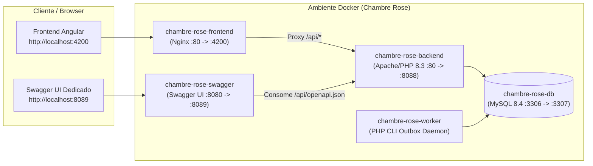

# Manual Técnico e Operacional — Chambre Rose

Este documento descreve a arquitetura, organização modular do código-fonte, portas de serviço, documentação interativa da API REST (OpenAPI 3.1 / Swagger), credenciais de acesso e procedimentos de operação e testes da plataforma **Chambre Rose**.

---

## 1. Visão Geral da Arquitetura

A plataforma **Chambre Rose** é um marketplace privado e diretório editorial suíço composto por:

- **Backend REST API (PHP 8.3 + PDO + Apache):** Arquitetura modular orientada a serviços e repositórios com autoloading PSR-4 estrito, autenticação JWT (`HttpOnly` cookie + `Bearer` token), proteção CSRF, rate limiting adaptativo, mensageria em tempo real via Server-Sent Events (SSE) e processamento de mídia em WebP/PNG.
- **Worker Assíncrono de Notificações (`bin/process-notification-outbox.php`):** Daemon dedicado para entrega de notificações Web Push (VAPID) e processamento de fila transacional (`notification_outbox`).
- **Frontend SPA (Angular 19 + Nginx):** Aplicação single-page com suporte bilíngue (`fr` / `en`), proxy reverso integrado para `/api/` e sistema de design calibrado com a paleta oficial da marca (**Carmin-Ruby `#8c0434`**, **Crimson-Rose `#b8143a`** e **Champagne Gold `#d49a35`**).
- **Documentação Interativa REST (OpenAPI 3.1.0 + Swagger UI):** Especificação completa servida tanto de forma embarcada na API quanto em um container Swagger UI dedicado.
- **Banco de Dados Relacional (MySQL 8.4):** Persistência transacional com migrações automáticas e controle de integridade referencial.



---

## 2. Portas, Containers e Endpoints de Acesso

| Serviço | Container Docker | Porta Local / URL | Descrição |
| :--- | :--- | :--- | :--- |
| **Frontend Web (SPA)** | `chambre-rose-frontend` | `http://localhost:4200` | Interface principal da plataforma (Angular + Nginx). |
| **API REST (Porta Dedicada)** | `chambre-rose-backend` | `http://localhost:8088/api` | Acesso direto aos endpoints REST da aplicação. |
| **Swagger UI (Container Dedicado)** | `chambre-rose-swagger` | `http://localhost:8089` | Interface Swagger UI dedicada para explorar e testar a API. |
| **Swagger UI (Integrado na API)** | `chambre-rose-backend` | `http://localhost:8088/api/docs` | Visualizador Swagger UI servido diretamente pelo backend PHP. |
| **Especificação OpenAPI 3.1** | `chambre-rose-backend` | `http://localhost:8088/api/openapi.json` | Contrato JSON OpenAPI 3.1.0 para importação no Postman/Insomnia. |
| **Healthcheck da API** | `chambre-rose-backend` | `http://localhost:8088/api/health` | Status da aplicação e conectividade com o banco de dados. |
| **Banco de Dados MySQL 8.4** | `chambre-rose-db` | `localhost:3307` | Banco `chambre_rose` (`user`: `chambre_rose` / `pass`: `chambre_rose_pass`). |
| **Notification Worker** | `chambre-rose-worker` | *(Background CLI)* | Processador contínuo da fila `notification_outbox`. |

---

## 3. Estrutura Modular do Código-Fonte (`src/`)

Os 84 arquivos do backend PHP estão organizados em **9 módulos de domínio** dentro de `src/`, mantendo o namespace `ChambreRose\` mapeado no `composer.json` com autoloading PSR-4 estrito:

```text
Chambre-Rose--PHP/
├── bin/                          # Scripts CLI (worker de notificações e migrações)
├── database/                     # Schema SQL base e migrações incrementais
├── deployment/                   # Scripts de manifesto, deploy e rollback
├── frontend/                     # Bundle SPA Angular e folha de estilo da marca
│   └── assets/
│       └── brand-theme.css       # Design System Carmin-Ruby & Champagne Gold
├── public/                       # Front-controller HTTP (index.php)
├── resources/
│   ├── brand/                    # Ativos oficiais da marca (brand-logo.png / webp)
│   └── openapi/
│       └── openapi.json          # Especificação completa OpenAPI 3.1.0
├── src/
│   ├── Core/                     # Kernel, Config, Env, Time, PromotionMode, SearchPagination
│   ├── Database/                 # Connection, Migrator, Seeder e migrações de domínio
│   ├── Http/                     # Request, Response, Router, Cors, ApiException, SecurityHeaders
│   ├── Media/                    # BrandLogoAsset, MediaContentRange, ImageRevalidator, Responsive Media
│   ├── Notifications/            # MailService, WebPushService, NotificationOutboxProcessor
│   ├── Repositories/             # 19 Repositórios PDO (User, Profile, Product, Appointment, Chat, etc.)
│   ├── Routes/                   # 7 Módulos de rotas (OpenApiRoutes, SeoRoutes, AddressSearch, etc.)
│   ├── Security/                 # Auth, Jwt, CsrfToken, RateLimiter, IdentityDocumentCrypto, Guards
│   └── Services/                 # 20 Serviços de negócio (AuthService, MarketplaceService, ChatService, etc.)
└── tests/                        # Suíte de testes automatizados (autoload + unitários + domínio)
```

### Detalhamento dos Módulos em `src/`

1. **`src/Core/`**: Inicialização e orquestração (`App.php`, `Config.php`, `Env.php`, `Time.php`, `PromotionMode.php`, `SearchPagination.php`).
2. **`src/Database/`**: Gerenciamento de conexão PDO (`Database.php`), execução de schema e migrações (`Migrator.php`, `ProfileImageCacheMigration.php`, `PromotionImageCacheMigration.php`) e carga inicial de dados (`Seeder.php`).
3. **`src/Http/`**: Abstrações HTTP imutáveis (`Request.php`, `Response.php`), roteador (`Router.php`), cabeçalhos de segurança (`SecurityHeaders.php`, `Cors.php`, `RequestMetadata.php`) e tratamento padronizado de erros (`ApiException.php`).
4. **`src/Media/`**: Processamento de fotos e vídeos com suporte a byte-range (`MediaContentRange.php`), geração de variantes responsivas WebP (`ProductResponsiveImageUrls.php`, `ProfilePhotoVariantStream.php`, `PromotionResponsiveImageStream.php`) e ativo oficial da marca (`BrandLogoAsset.php`).
5. **`src/Notifications/`**: Disparo de e-mails transacionais bilíngues (`MailService.php`), criptografia e entrega Web Push VAPID (`WebPushService.php`) e processamento assíncrono (`NotificationOutboxProcessor.php`).
6. **`src/Repositories/`**: Camada de acesso a dados com queries parametrizadas PDO (`UserRepository.php`, `ProfileRepository.php`, `ProductRepository.php`, `PromotionRepository.php`, `AppointmentRepository.php`, `ChatRepository.php`, `ReviewRepository.php`, `SubscriptionRepository.php`, etc.).
7. **`src/Routes/`**: Controladores modulares de rotas (`OpenApiRoutes.php`, `SeoRoutes.php`, `AddressSearchRoutes.php`, `AppointmentCalendarRoutes.php`, `ProductMediaRoutes.php`, `ProfilePhotoRoutes.php`, `PromotionMediaRoutes.php`).
8. **`src/Security/`**: Autenticação JWT (`Auth.php`, `Jwt.php`), proteção contra falsificação de requisição (`CsrfToken.php`), criptografia de documentos de identidade (`IdentityDocumentCrypto.php`), validação de senhas e perfis (`PasswordPolicy.php`, `ProfileInputValidator.php`) e controle de taxa (`RateLimiter.php`).
9. **`src/Services/`**: Regras de negócio da plataforma (`AuthService.php`, `MarketplaceService.php`, `AccountService.php`, `AdminService.php`, `AppointmentService.php`, `ChatService.php`, `CartService.php`, `ReviewService.php`, `StoreOrderService.php`, `SubscriptionService.php`, etc.).

---

## 4. Documentação da API REST (Swagger / OpenAPI 3.1)

A especificação OpenAPI 3.1 (`resources/openapi/openapi.json`) organiza todos os endpoints da aplicação em **14 grupos funcionais**:

| Tag / Domínio | Principais Endpoints | Descrição |
| :--- | :--- | :--- |
| **System & Docs** | `GET /api/health`, `GET /api/openapi.json`, `GET /api/docs`, `GET /api/brand/logo` | Saúde do serviço, especificação OpenAPI, Swagger UI e logotipo oficial. |
| **SEO** | `GET /api/seo/sitemap.xml`, `GET /api/seo/meta` | Sitemap XML dinâmico e metadados estruturados por rota. |
| **Authentication** | `POST /api/auth/login`, `POST /api/auth/register`, `POST /api/auth/logout`, `GET /api/auth/me` | Login, cadastro com documento de identidade, recuperação de senha e sessão. |
| **Listings & Profiles** | `GET /api/listings`, `GET /api/listings/{id}`, `GET /api/profiles/{userId}/media/{mediaId}` | Catálogo público de acompanhantes e boutiques, busca paginada e mídia responsiva. |
| **Products & Catalog** | `GET /api/products`, `GET /api/products/{id}`, `GET /api/stores` | Catálogo de produtos íntimos, variantes de imagem WebP e lojas parceiras. |
| **Promotions** | `GET /api/promotions`, `POST /api/account/promotions`, `PATCH /api/account/promotions/{id}` | Campanhas promocionais públicas e gestão de ofertas por profissionais/lojas. |
| **Cart & Checkout** | `GET /api/cart`, `POST /api/cart/items`, `POST /api/cart/checkout` | Carrinho de compras e finalização de pedidos nas boutiques. |
| **Appointments** | `GET /api/appointments`, `POST /api/appointments`, `GET /api/appointments/availability/{userId}` | Agendamentos, consulta de horários disponíveis e confirmação/cancelamento. |
| **Chat & Realtime** | `GET /api/chats`, `GET /api/chats/{id}/messages`, `POST /api/chats/{id}/messages`, `GET /api/chats/stream` | Conversas privadas, envio de mensagens e stream SSE em tempo real. |
| **Reviews & Favorites** | `POST /api/listings/{id}/reviews`, `GET /api/favorites`, `POST /api/favorites/{userId}` | Avaliações moderadas, respostas do profissional e lista de favoritos. |
| **Account & Profile** | `GET /api/account/profile`, `PUT /api/account/profile`, `POST /api/account/media` | Gestão do próprio perfil profissional, galeria de fotos/vídeos e disponibilidade. |
| **Store Orders** | `GET /api/account/store-orders`, `PATCH /api/account/store-orders/{id}` | Gestão de pedidos recebidos pelas boutiques. |
| **Subscriptions & Push** | `GET /api/subscriptions/plans`, `POST /api/subscriptions`, `POST /api/push/subscribe` | Planos VIP/Profissionais e assinatura de notificações Web Push. |
| **Administration** | `GET /api/admin/users`, `PATCH /api/admin/users/{id}/approval`, `GET /api/admin/reviews` | Painel administrativo para aprovação de contas, documentos, mídia e avaliações. |

---

## 5. Credenciais de Acesso (Ambiente Local)

As contas abaixo são provisionadas automaticamente com perfis editoriais realistas:

| Perfil | E-mail | Senha | Papel (`role`) |
| :--- | :--- | :--- | :--- |
| **Administrador** | `admin@admin.com` | `ChambreRose2026!Admin` | `ADMIN` |
| **Acompanhante (Escort)** | `acompanhante@chambre-rose.com` | `ChambreRose2026!Escort` | `ESCORT` |
| **Boutique / Loja** | `loja@chambre-rose.com` | `ChambreRose2026!Store` | `SEX_SHOP` |
| **Cliente / Visitante** | `visitante@chambre-rose.com` | `ChambreRose2026!User` | `VISITOR` |

---

## 6. Identidade Visual e Design System

A interface gráfica (`frontend/assets/brand-theme.css`) segue a paleta extraída diretamente do logotipo oficial (`resources/brand/brand-logo.png`) combinada com princípios de hierarquia, contraste e espaçamento inspirados no Apple Human Interface Guidelines:

- **Primary (Crimson-Rose):** `#b8143a`
- **Primary Dark (Carmin-Ruby):** `#8c0434`
- **Accent (Champagne Gold):** `#d49a35` / `#edd098`
- **Surfaces:** Tons quentes de marfim rosado (`#fdf8f6`, `#fffcfb`) com bordas translúcidas (`rgba(140, 4, 52, 0.12)`) e sombras difusas calibradas.
- **Componentes de Catálogo (`.category-rail` e `.filters-toggle`):**
  - Rótulo `Categories` com fundo transparente e tipografia editorial em caixa alta.
  - Botões de categoria inativos em superfície clara (`#fff9f7`) com ícones em pílula suave (`rgba(184, 20, 58, 0.11)`) e alto contraste em rubi escuro (`#8c0434`).
  - Botão de categoria ativo em gradiente carmim-rubi (`#c41840` → `#820430`) com ícone e texto brancos.

---

## 7. Comandos Operacionais e Bateria de Testes

### Gerenciamento dos Containers Docker
```powershell
# Subir todos os serviços (DB, Backend API, Worker, Frontend e Swagger UI)
docker compose -f Chambre-Rose--PHP/docker-compose.yml up -d

# Verificar status dos containers
docker compose -f Chambre-Rose--PHP/docker-compose.yml ps

# Regenerar autoloader PSR-4 estrito do Composer
docker exec chambre-rose-backend composer dump-autoload --no-dev --optimize --strict-psr
```

### Execução da Bateria de Testes Automatizados
```powershell
# 1. Teste de integridade PSR-4 e carregamento de todas as classes em src/
docker exec chambre-rose-backend env -i PATH=/usr/local/sbin:/usr/local/bin:/usr/sbin:/usr/bin:/sbin:/bin php tests/autoload.php

# 2. Suíte completa de testes unitários, validação, segurança, mídia e OpenAPI
docker exec chambre-rose-backend env -i PATH=/usr/local/sbin:/usr/local/bin:/usr/sbin:/usr/bin:/sbin:/bin php tests/run.php

# 3. Testes de manifesto de release e rollback de deploy
python Chambre-Rose--PHP/deployment/test-release-manifest.py
python Chambre-Rose--PHP/deployment/test-release-rollback.py
```

